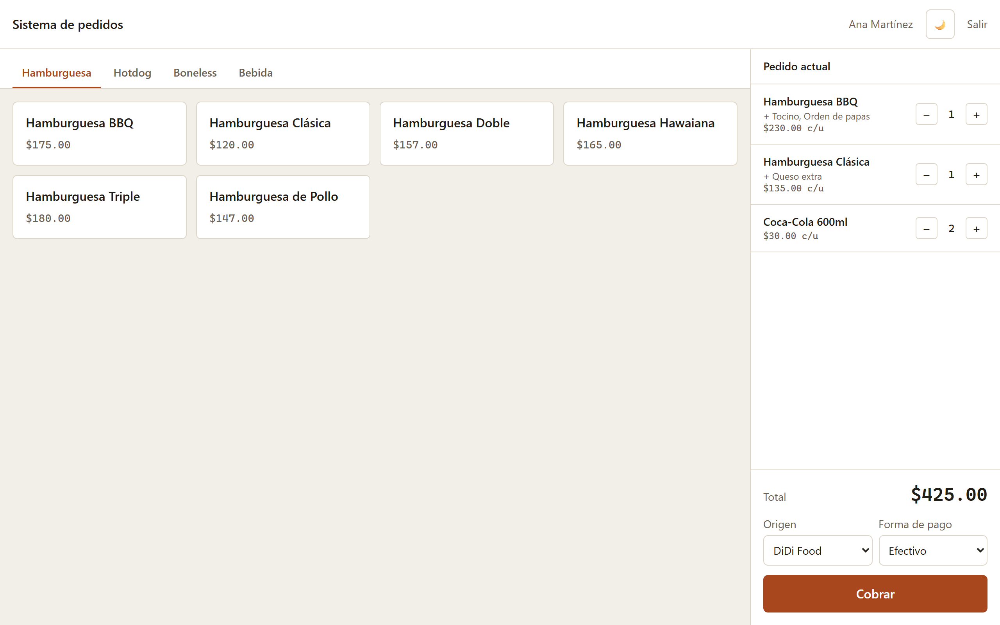
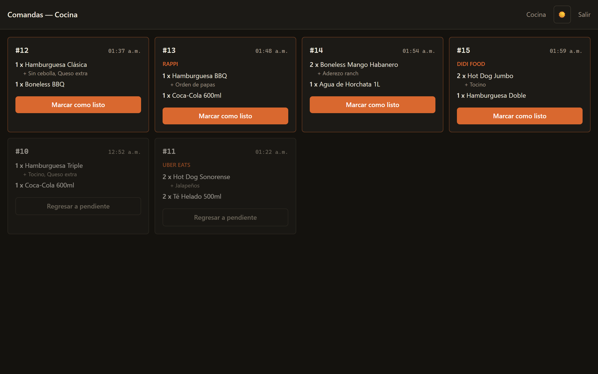
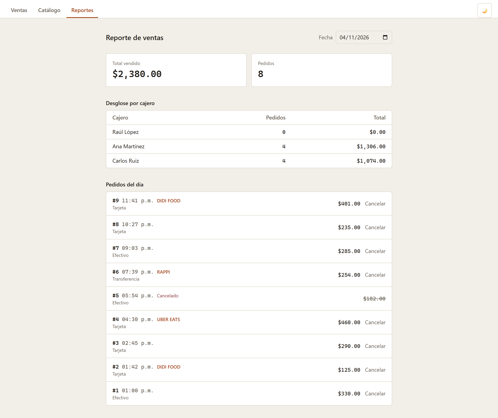
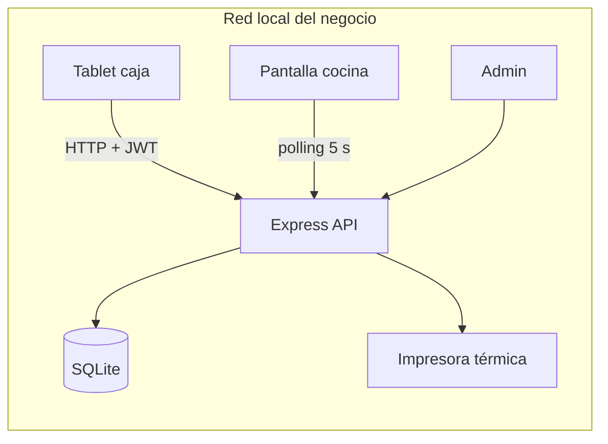

# POS Hamburguesas

Sistema de punto de venta para un negocio de comida rápida (hamburguesas, hot dogs y boneless) en Culiacán, Sinaloa. Corre en una PC del local y se usa desde tablets o celulares en la misma red: el cajero toma pedidos, la cocina ve las comandas en tiempo real y el administrador consulta el corte del día.


<!-- Agrega capturas en docs/capturas/ y descomenta:
| Caja | Cocina | Reportes |
|------|--------|----------|
|  |  |  |
-->

## Funcionalidades

- **Caja:** catálogo por categorías, extras por producto (queso, tocino…) filtrados según la categoría, origen del pedido (local, DiDi, Uber Eats, Rappi) y forma de pago.
- **Cocina:** pantalla de comandas que se actualiza sola cada 5 s; cada comanda se marca como lista. La comanda **no muestra precios**.
- **Impresora térmica:** impresión ESC/POS de la comanda (USB o red). Si la impresora falla, la venta **no se pierde** y se puede reimprimir.
- **Reportes:** total del día, desglose por cajero y cancelación de pedidos con motivo.
- **Administración:** alta y edición de productos, extras y usuarios, con bajas lógicas para conservar el historial.
- **Auditoría:** se registran inicios de sesión fallidos, ventas, cancelaciones y cambios al catálogo y a los usuarios.
- **Tema claro/oscuro** que sigue al sistema o se elige a mano.

## Stack

| Capa | Tecnología |
|------|------------|
| Backend | Node.js, Express 5, better-sqlite3, Zod, JWT, bcrypt, helmet, express-rate-limit |
| Frontend | React 19, Vite, Tailwind CSS 4 |
| Calidad | Jest + Supertest, ESLint, Oxlint, Prettier, GitHub Actions |
| Hardware | node-thermal-printer (ESC/POS) |

## Arquitectura



El backend está organizado en capas:

```
src/
├── routes/      HTTP: validación (Zod), permisos por rol, códigos de respuesta
├── services/    reglas de negocio: armar el pedido, cálculos, comanda/ticket, impresión
├── models/      acceso a SQLite con consultas preparadas
├── middleware/  auth, validación, manejo de errores
└── schemas/     esquemas de Zod para cada endpoint
```

## Decisiones técnicas

- **Dinero en centavos enteros.** Todos los precios se guardan como `INTEGER` ($85.00 = `8500`) para evitar errores de punto flotante. La conversión a pesos ocurre en un solo lugar del frontend (`lib/dinero.js`).
- **El servidor calcula el total.** El cliente solo manda IDs y cantidades; los precios salen de la base de datos, así no se puede alterar el total desde el navegador.
- **Precio congelado en cada venta.** `pedido_items` y `pedido_item_extras` guardan el precio del momento de la venta, así un cambio de precio no altera reportes pasados.
- **Sesión con dos tokens:**
  - *Access token* JWT de 15 min que vive **solo en memoria** (nunca en `localStorage`, para que un ataque XSS no lo pueda robar).
  - *Refresh token* aleatorio en una cookie `httpOnly` + `SameSite=Strict`. En la base solo se guarda su **hash SHA-256** y **rota en cada uso**.
  - Si varias peticiones expiran al mismo tiempo, el frontend las agrupa en un solo refresco.
  - Dar de baja a un usuario revoca todas sus sesiones.
- **SQLite en modo WAL.** Para un solo local es más que suficiente, no requiere un servidor de base de datos y se respalda en caliente (`npm run backup`).
- **Zona horaria fija.** Las fechas se guardan en UTC y los reportes se agrupan por día en hora de Sinaloa (UTC-7, sin horario de verano).

## Cómo correrlo

Requisitos: Node.js 20 o superior.

```bash
# 1. Backend
npm install
cp .env.example .env
npm run secreto            # copia el resultado a JWT_SECRET en .env
npm run crear-usuario -- "Administrador" admin admin   # pide la contraseña
npm run seed               # (opcional) carga un menú de ejemplo
npm run dev                # http://localhost:3000

# 2. Frontend (otra terminal)
cd frontend
npm install
cp .env.example .env
npm run dev                # http://localhost:5173
```

Para usarlo desde otros dispositivos de la red, agrega `http://<IP-de-la-PC>:5173` a `FRONTEND_URL` en `.env` y pon `VITE_API_URL=http://<IP-de-la-PC>:3000` en `frontend/.env`.

### Scripts del backend

| Comando | Qué hace |
|---------|----------|
| `npm run dev` | Servidor con recarga automática |
| `npm test` | Tests unitarios y de API (BD en memoria) |
| `npm run lint` | ESLint |
| `npm run crear-usuario -- "Nombre" usuario rol` | Crea un usuario (`admin`, `cajero` o `cocina`) |
| `npm run seed` | Carga un menú de ejemplo |
| `npm run backup` | Respaldo en caliente de la BD en `respaldos/` (guarda los últimos 30) |
| `npm run secreto` | Genera un `JWT_SECRET` aleatorio |

## API

| Método | Ruta | Rol |
|--------|------|-----|
| `POST` | `/auth/login` · `/auth/refrescar` · `/auth/logout` | público |
| `GET` | `/productos` · `/extras` | autenticado |
| `POST` `PUT` `DELETE` | `/productos/:id` · `/extras/:id` | admin |
| `POST` | `/pedidos` | cajero, admin |
| `GET` | `/pedidos?fecha=` · `/pedidos/:id` | cajero (solo los suyos), admin |
| `POST` | `/pedidos/:id/reimprimir` | cajero (solo los suyos), admin |
| `DELETE` | `/pedidos/:id` | admin |
| `GET` `PATCH` | `/cocina` · `/cocina/:id` | cocina, admin |
| `GET` | `/ventas/dia` · `/ventas/por-cajero` · `/ventas/corte` · `/ventas/historial` | admin |
| `GET` `POST` `PUT` `DELETE` | `/usuarios` | admin |

## Tests

`npm test` corre las pruebas unitarias de cálculos y comandas, y pruebas de integración de la API con Supertest sobre una base de datos en memoria. Cubren:

- Login, rotación y revocación del refresh token.
- Permisos por rol (el cajero no edita el catálogo, la cocina no vende…).
- Que el total se calcule en el servidor y que los extras se validen por categoría.
- Aislamiento de pedidos entre cajeros.
- Que las cancelaciones se descuenten del corte.
- Validación de entradas y protección del último administrador.

## Autor

**Raúl López**: [GitHub](https://github.com/JRLR22)
